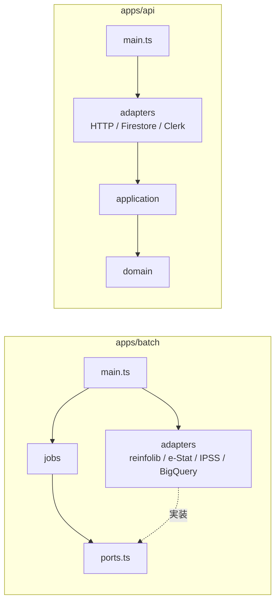

# 基本設計

[要件定義](requirements.md) をどう実現するかの方針。構成の絵は [システム構成図](system-architecture.md)、GCP は [インフラ構成図](infrastructure.md)。

## 1. 方式の要点

| 方針 | 理由 |
|---|---|
| **公的 API を呼ぶのはバッチだけ** | レート制限と API キーを 1 か所に閉じ込める |
| **取得データは加工せず raw に保存し、集計は BigQuery の SQL で** | 解釈を変えても取り直さずに作り直せる |
| **画面は全ページをビルド時に静的生成し CDN から配る** | 閲覧に DB もサーバーも要らず、速く安い |
| **利用者のデータだけ保存 API + Firestore** | 動的な部分を最小にする |
| **ログインは PropFolio と同じ Clerk アプリ** | 片方でログインすれば両方でログイン済み |

## 2. 構成要素と責務

| 部品 | 責務 | 実行環境 | 詳細 |
|---|---|---|---|
| `apps/batch` | 公的データの取得 → raw 保存 → 集計 → 書き出し | Cloud Run Jobs | [バッチ](detailed-design/batch.md) |
| `apps/api` | 本人のお気に入り等の読み書き、退会への追従 | Cloud Run | [保存 API](detailed-design/api.md) |
| `apps/web` | 書き出しを取り込み全ページを HTML に | Cloud Storage + Cloud CDN | [画面](detailed-design/web.md) |
| `packages/shared` | 型・zod スキーマ・共通の定数 | — | 各詳細設計 |

## 3. 層の分け方

### バッチ・保存 API（ポートとアダプタ）

- 依存は外から内への一方向。Biome の `noRestrictedImports`（`biome.json` の `overrides`）で強制する
- domain・application・jobs は zod、`@google-cloud/*`、`node:*` を import できない
- 実装を選んで組み立てるのは `main.ts` だけ

### 画面

- ルーターを使わず、ページ（`Route`）ごとに 1 HTML を書き出してハイドレーションする
- 詳細データは HTML に埋め込み、クライアントの JS には含めない

## 4. データの持ち方

| 置き場所 | 中身 | 書く人 | 読む人 |
|---|---|---|---|
| BigQuery `raw_*` | 公的 API の応答そのまま | バッチ | 集計 SQL |
| BigQuery 集計テーブル | 指標・分布・事例 | 集計 SQL | 書き出し |
| GCS データ用バケット `exports/` | 集計テーブルの JSON | バッチ（aggregate） | GitHub Actions |
| 画面のビルド成果物 | HTML・JS・JSON | GitHub Actions | 利用者（CDN 経由） |
| Firestore `area-insight-users` | 利用者のデータ | 保存 API | 保存 API |
| ブラウザ localStorage | 比較リスト | 画面 | 画面 |

構造は [ER 図](er-diagram.md)。

## 5. 非機能の実現

| 要件 | 実現方法 |
|---|---|
| 冪等性 | ロードジョブの `WRITE_TRUNCATE` で同じ範囲を置き換える。集計は `CREATE OR REPLACE` |
| 失敗に強い | 取得が途中で失敗したらロードしない。Workflows は失敗したら後続を止め、画面は作り直さない |
| 配信の切り替え | ハッシュ付き assets を先に、HTML を後に置く。古い assets は残す |
| 外部データの検証 | API 応答・リクエスト本文・書き出し・保存済みデータを zod で検証する |
| 認証 | Clerk のセッション JWT を JWKS で検証。`iss` と `azp` を確認する |
| API の保護 | ingress はロードバランサ経由のみ。Cloud Armor でレート制限 |
| 配信の保護 | TLS 1.2 以上、CSP などのセキュリティヘッダーを LB で付与 |
| 秘匿情報 | Secret Manager から環境変数に注入。検証エラーでも変数名だけを出す |
| ログ | API は `{method, path, status, ms}` だけを出す |

## 6. 技術選定

| 領域 | 採用 |
|---|---|
| 言語 | TypeScript（strict）、Node.js 22.12 以上 |
| パッケージ | pnpm workspace |
| 画面 | React 19、Vite、Tailwind CSS v4、shadcn/ui（Radix）、lucide、MapLibre GL |
| 検証 | zod |
| 認証 | Clerk（画面は `@clerk/clerk-js`・`@clerk/ui`、API は `jose`） |
| データ | BigQuery、Firestore、Cloud Storage |
| lint / 整形 | Biome |
| テスト | Vitest |
| CI/CD | GitHub Actions（Workload Identity 連携） |
| インフラ | Terraform（maaun-terraform リポジトリ） |

## 7. リリースとデプロイ

| 対象 | 契機 | 反映 |
|---|---|---|
| 画面 | `main` へのマージ、データ更新の通知 | `deploy.yml` がそのままバケットへ置く |
| バッチ・保存 API | ルートの `package.json` の `version` が未リリース | `deploy.yml` がイメージを push しタグを作る。**稼働は maaun-terraform の tfvars で切り替える** |

流れは [シーケンス図](sequence-diagrams.md#5-リリース)。
