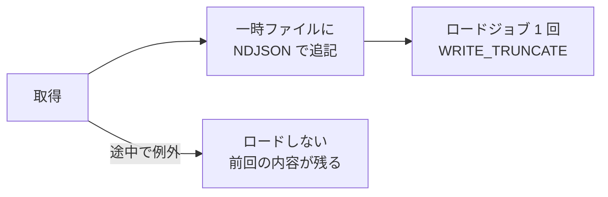

# 詳細設計: バッチ（apps/batch）

外部 API は [外部連携](../external-integrations.md)、テーブルの関係は [ER 図](../er-diagram.md)、実行環境は [インフラ構成図](../infrastructure.md#バッチのジョブ)。

## 1. 構成

| 場所 | 役割 |
|---|---|
| `src/jobs/*` | ジョブ。ポートにだけ依存する |
| `src/ports.ts` | `PublicDataSource` / `StatisticsSource` / `ProjectionSource` / `TileCatalog` / `RawDataStore` / `MetricsWarehouse` |
| `src/adapters/*` | reinfolib、e-Stat、IPSS、BigQuery、タイル一覧の実装 |
| `src/main.ts` | 引数でジョブを選び、実装を組み立てる |
| `tiles/z11.json`、`z13.json` | 陸地を含むタイルの一覧（2,298 枚 / 28,897 枚） |

実行と移行の詳細は [GitHub Actions バッチ](../batch-actions.md)。

## 2. 起動

```
node dist/main.js <ジョブ> [--recent N] [--quarter YYYYQn ...] [--year YYYY] [--all-tiles]
```

- 結果は 1 行の JSON（`{job, 件数...}`）を標準出力へ
- 地価の分割取得: `land-prices --year YYYY --all-tiles --part 0 --parts 8 --output /tmp/0.ndjson`
- 全分割の一括ロード: `load-land-prices --year YYYY --parts 8 --source-prefix gs://bucket/batch-staging/run-id`
- 失敗はメッセージだけを stderr に出して exit 1（URL・鍵は含めない）

## 3. ジョブ

| ジョブ | 取得元 | 保存先 | 引数と既定 | 置き換える範囲 |
|---|---|---|---|---|
| municipalities | XIT002 × 47 都道府県 | `raw_municipalities` | — | 全体 |
| transactions | XIT001 × 47 × 四半期 | `raw_transactions` | `--recent 4` または `--quarter` | 四半期のパーティション |
| land-prices | XPT002（z13、種類 0/1） | `raw_land_prices` | `--year`（既定は今年）、`--all-tiles` | 年のパーティション |
| station-transactions | XPT001（z11） | `raw_station_transactions` | `--recent 8` | 全体 |
| condo-transactions | XPT001（z11） | `raw_condo_transactions` | `--recent 20`（5 年） | 全体 |
| stations | XKT015（z11） | `raw_stations` | — | 全体 |
| statistics | e-Stat 4 表 | `raw_statistics` | — | 全体 |
| projections | 社人研 Excel × 47 | `raw_population_projection` | — | 全体 |
| aggregate | BigQuery | 集計テーブル → GCS | — | 全体（`CREATE OR REPLACE`） |

補足:

- 四半期は**公表が追いつかない当四半期を除き**、直前から数える（UTC）
- land-prices は既定で**過去に地点があったタイルだけ**取る。新しい地点を拾うため数年に 1 回 `--all-tiles`
- タイル系はタイル 1 枚ずつ保存先へ流し、メモリを抑える

## 4. 保存（raw）



| 決まり | 内容 |
|---|---|
| 加工しない | 値は文字列のまま。空文字だけ NULL |
| テーブル作成 | 無ければ作る。パーティション指定の表は DATE 列の日単位 |
| ストリーミング挿入 | 使わない（ロードジョブは無料） |
| JSON 列 | オブジェクトのまま渡す（v0.2.0 以前の文字列形式も集計で読める） |

列は [ER 図 §1](../er-diagram.md#1-bigquery-raw-テーブル)。

## 5. 集計（aggregate）

作る順: `land_price_points` → `area_metrics` → `area_details` → `district_land_prices` → `station_metrics` → `station_land_prices` → `condo_transactions` → `data_sources`

文字列はここで初めて数値にする（「4,700万円」、和暦の建築年、「1.2km」など）。市区町村コードは 5 桁に 0 埋めする。

### area_metrics

| 指標 | 計算 |
|---|---|
| 取引価格・件数 | 宅地(土地と建物)、直近 4 四半期の中央値 |
| 土地の取引単価 | 宅地(土地)の㎡単価、直近 8 四半期の中央値 |
| 土地の前年比 | 直近 4 四半期 vs その前の 4 四半期。両方 10 件以上のときだけ |
| 公示・基準地価 | 住宅地の中央値と前年比の中央値 |
| 取引 ÷ 公示地価 | 土地が 10 件以上のときだけ |
| 空き家率 / 放置率 / 増減 | 空き家 ÷ 総数 / その他 ÷ 総数 / 前回調査との差 |
| 家賃相場 | 1㎡家賃 × 戸建の延床面積の中央値（1000 円単位） |
| 利回り | 家賃相場 × 12 ÷ 取引価格 |
| 人口・増減率 | 住基人口の最新年と 5 年前比 |
| 将来人口 | 2050 年推計と 2020 年比 |
| 市場の歪み | 都道府県内の `PERCENT_RANK` の差（-100〜100）。比べる相手が 5 未満なら NULL。参考値は順位から外す |
| 需要の弱さ | 利回り上位 2 割 かつ 人口減 かつ 空き家率上位 2 割 |

### その他のテーブル

| テーブル | 中身 |
|---|---|
| `land_price_points` | 公示・調査それぞれ最新年の地点 |
| `area_details` | 四半期・年ごとの推移（5 年）、直近の取引 8 件、人口の推移と推計、距離帯別の地価、空き家の内訳 |
| `district_land_prices` | 地区ごと・市区町村全体の㎡単価の分布（21 点） |
| `station_metrics` | 駅ごとの戸建の総額中央値（直近 4 四半期）。駅名は 300m 以内の最寄りの駅の線から |
| `station_land_prices` | 駅ごとの土地㎡単価の 25 / 50 / 75%。地価の前年比で最新時点に補正。同名駅の距離帯別の地価を付ける |
| `condo_transactions` | 中古マンションの事例 1 件ずつ。時期・価格・面積が読めない行は出さない |
| `data_sources` | 指標ごとの出典と時点 |

駅名の突き合わせは NFKC と「ケ」→「ヶ」で正規化し、必要なら事業者の接頭辞（JR など）を外す。

### 書き出し

8 テーブルを `EXPORT DATA` で `gs://<DATA_BUCKET>/exports/<テーブル>/*.json` へ（上書き）。各行に `export_id`（実行時刻）を付け、画面は最新の行だけを使う。

## 6. 設定

| 環境変数 | 必須 | 用途 |
|---|---|---|
| `GCP_PROJECT_ID` | ○ | プロジェクト |
| `BIGQUERY_DATASET` | ○ | raw と集計のデータセット |
| `REINFOLIB_API_KEY` | reinfolib 系ジョブ | Secret Manager |
| `ESTAT_APP_ID` | statistics | Secret Manager |
| `DATA_BUCKET` | aggregate | 書き出し先 |
| `REQUEST_INTERVAL_MS` | — | 既定 1000 |

検証エラーは変数名だけを出す。

## 7. 手で動かすスクリプト

| スクリプト | 入力 | 出力 | 頻度 |
|---|---|---|---|
| `scripts/build-tiles.mjs` | 国土数値情報 N03 | `tiles/z11.json`、`z13.json` | 行政区域が変わったとき |
| `scripts/build-boundaries.mjs` | 国土数値情報 N03 | `apps/web/src/data/boundaries.json`（間引き・小数 4 桁） | 年 1 回 |

## 8. テスト

ネットワークと BigQuery は使わない。ジョブは Fake のポートで、集計は生成した SQL 文字列に必要な要素があるかで確かめる（SQL は実行しない）。
