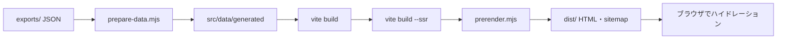

# 詳細設計: 画面（apps/web）

遷移は [画面遷移図](../screen-flow.md)、用語は [ユビキタス言語](../ubiquitous-language.md)。

## 1. 仕組み

| 段階 | やること |
|---|---|
| データの準備 | 書き出しを画面の形に変換（[§7](#7-データの準備)） |
| プリレンダー | ページごとに title・description・canonical を入れ、本文を `renderToString`、ルートの JSON を `<script id="route">` に埋め込む。sitemap を作る |
| ハイドレーション | `#route` を読み（詳細は zod で再検証）、`hydrateRoot`。その後 `initAuth()`・`initUserData()` |

- ルーターは使わない。開発サーバーでは URL からページを決める
- URL クエリは `useSearchParams`（SSR 直後は空として扱う）と `replaceSearchParams`（履歴を増やさない）

## 2. 共通レイアウト

| 画面幅 | 構成 |
|---|---|
| lg 以上 | 左に固定サイドバー（ロゴ、検索、メニュー、データ更新日、ログイン） |
| lg 未満 | 上にヘッダー（ロゴ、検索、ログイン）、下に 5 タブ |

- メニュー: ホーム / 地図で探す / マンション成約事例 / ランキング / 比較（比較リストの件数をバッジ表示）
- サンプルデータのときは全ページに「数値はすべてサンプル」と出す
- フッター: データ更新日、免責、運営会社と PropFolio へのリンク、出典（API 規約の定型文を含む）、規約へのリンク

## 3. ページ

### ホーム `/`

| ブロック | 内容 |
|---|---|
| ヒーロー | 対象の市区町村数、検索、地図へ、利回り TOP3 |
| 入口 | 地図 / ランキング / 比較 |
| 主なランキング | 4 タブ × 上位 8 件（参考値を除く）。「すべて見る」でランキングへ |

| タブ | 指標 | 並び |
|---|---|---|
| 利回りが高い | grossYield | 降順 |
| 価格が手ごろ | tradePrice | 昇順 |
| 人口が増加 | populationChangeRate | 降順 |
| 家賃が割安 | rentGap | 降順 |

### 市区町村の詳細 `/areas/{code}/`

上から順に:

| # | ブロック | 中身 |
|---|---|---|
| 1 | ヘッダー | パンくず、名前、比較に追加・お気に入り、[一言の判定](#一言の判定) |
| 2 | 主な指標 | 取引価格・利回り・空き家率・人口増減率。時点と都道府県内の順位 |
| 3 | 土地 | 価格チェッカー、地区ごとの単価、公示地価との比較、距離帯別の地価 |
| 4 | 駅ごとの土地 | 駅ごとの妥当な範囲（地価補正済み） |
| 5 | 空き家 | 率・放置率・増減、内訳の帯グラフ |
| 6 | 市場の歪み | 3 種の歪み、取引 ÷ 公示地価、需要の弱さの警告 |
| 7 | 取引価格の推移 | 四半期 / 年の折れ線と表（前年比、件数） |
| 8 | PropFolio | 「この相場で収支を計算する」 |
| 9 | 人口 | 推移、2050 年の推計 |
| 10 | 近くの市区町村 | 代表点が近い 4 件、地図へのリンク、都道府県のマンション成約事例へのリンク（事例がある都道府県だけ） |
| 11 | 直近の取引 | 8 件（地区名まで） |

### ランキング `/rankings/`

| 操作 | 仕様 |
|---|---|
| 指標 | 13 指標（基本 / 空き家 / 市場の歪み）。既定は grossYield |
| 並び | 指標の良い向きが既定。切り替え可 |
| 都道府県 | 全国 または 1 都道府県 |
| 参考値も含める | 取引系の指標だけ。既定は除く（除いた数を表示） |
| データなしを除く | 既定は末尾に並べる |
| ページ | 50 件ずつ。条件を変えたら 1 ページ目へ |
| 条件の保存 | ログイン時。名前は条件の要約、最大 20、同名不可 |

- 歪みの指標では需要の弱い市区町村を除き、「投資判断の助言ではありません」と出す
- 各行に「比較に追加」

### 比較 `/compare/`

- 対象: `?codes=` を優先（正しいコードだけ、最大 3）。無ければ比較リスト。URL で開いたら比較リストにも反映
- 13 指標を並べ、2 件以上に値がある指標は良い方を強調
- 列の × で外す。空き枠から検索で追加。0 件なら探し方を案内

### 地図 `/map/`

| 項目 | 仕様 |
|---|---|
| 塗り分け | 12 指標（人口を除く）。5 段階の分位。既定は tradePrice |
| 重ねる層 | 市区町村 / 地価の地点 / 駅の相場（地点と駅は zoom 8 以上） |
| 選択 | クリックでカードを表示（市区町村 → 詳細へ） |
| `?area=` | その市区町村に zoom 10 で寄せて選択 |
| 背景 | 淡色（既定）/ 標準 / 写真 / 建物 から選ぶ。選択は localStorage `machinome:basemap` に残す（マンションのページと共通） |
| 読み込み | 境界（約 3MB）と MapLibre はこのページでだけ取る |

### マンション成約事例 `/condos/`

| 絞り込み | クエリ | 既定 |
|---|---|---|
| 都道府県 | `pref` | 13（東京都） |
| 時期 | `years` | 直近 5 年（1 / 3 / 5） |
| 価格の種類 | `kind` | すべて |
| 間取り | `plans` | すべて |
| 専有面積 | `amin` / `amax` | 指定なし（20〜100㎡） |
| 築年数 | `agemin` / `agemax` | 指定なし（5〜40 年） |
| 事情のある取引 | `special=1` | 除く |

- 地図: 駅ごとの円。色 = 坪単価の中央値の分位、大きさ = 件数。背景は地図ページと同じく選べる
- サマリー: 坪単価の中央値とよくある範囲、件数、価格・面積の中央値（10 件未満は参考値）
- 仕入れの目安: 面積を入れると 25 / 50 / 75% 点の価格（10 万円単位）
- 駅の一覧 10 件ずつ、事例の一覧 20 件ずつ

### その他

| ページ | 内容 |
|---|---|
| `/terms/`、`/privacy/` | 利用規約、プライバシーポリシー（制定 2026-10-16） |
| `/version/` | `v{版}` |
| 404 / 401 | 見つからない / 公開準備中 |

### 検索ダイアログ

- 開く: ⌘K、Ctrl+K、`/`、検索ボタン
- 空欄: ページ一覧。入力あり: 「都道府県名+市区町村名」の部分一致で最大 8 件（取引価格付き）
- ↑↓ で選び Enter で移動。全件をブラウザに持ち、その場で絞る

## 4. ロジック

### 参考値とランキング対象

| 指標 | 参考値の条件 |
|---|---|
| tradePrice、grossYield | `tradeCount` < 10 |
| landUnitPrice | `landTradeCount` < 10 |
| 人口・空き家 | なし（統計値のため） |

- 歪みの指標では `weakDemand` を除く
- 値が null の行は末尾に並べる
- 都道府県内の順位は良い向きに並べた順位と母数

### 一言の判定

| 観点 | 条件 → 文（トーン） |
|---|---|
| 価格（都道府県内の安い順の位置。母数 3 未満は出さない） | 1/3 以下 → 安い部類（good）、2/3 超 → 高い部類（bad）、他 → 中ほど |
| 人口増減率 | 0 以上 → 増えている（good）、-3 超 → 微減、他 → 減っている（bad） |
| 空き家率 | 20% 以上 → 多い（bad）、12% 未満 → 少なめ（good）、他 → 全国並み |

### 土地の価格チェック

分布の位置（0〜100、分位の間は線形補間）で判定する。地区の件数が 10 件未満なら市区町村全体の分布を使う。

| 位置 | 判定 |
|---|---|
| < 20 | かなり安い |
| < 40 | 安め |
| ≤ 60 | 相場並み |
| ≤ 80 | 高め |
| > 80 | かなり高い |

取引 ÷ 公示地価: 0.95 未満 = 公示地価より安く、1.05 以下 = ほぼ同じ水準、それ超 = 高く。

### 時点の表記

| データ | 表記 |
|---|---|
| 期間 | YYYY年M月〜YYYY年M月の取引 |
| 住宅・土地統計調査 | YYYY年調査 |
| 社人研 | YYYY年推計（2020年国勢調査基準） |
| その他の時点 | YYYY年M月D日時点（無ければ「時点不明」） |

利回り（家賃と取引）・rentGap（人口と家賃）は、根拠の時点が **2 年以上**離れていれば注記する。

### 表示の形式

| 種類 | 形式 |
|---|---|
| null | データなし |
| 坪単価 | 1 坪 = 400/121㎡。万円/坪、小数 1 桁 |
| % / pt | 小数 1 桁（増減は + 付き） |
| 歪み | 整数 + pt |
| 倍率 | 小数 2 桁 |
| 距離 | 1000m 以上は km |
| 四半期 | 2025年4〜6月 |

## 5. ログイン

| 状態 | 表示 |
|---|---|
| disabled（公開キー未設定） | ログイン・お気に入り・条件保存の UI を出さない |
| loading | ボタンの場所だけ確保 |
| signed-out | 「Google でログイン」 |
| signed-in | Clerk の UserButton、ログアウト |

Clerk 本体（`@clerk/clerk-js` とログイン画面の部品 `@clerk/ui`、日本語化）は次のときだけ動的 import する（閲覧だけの人には読ませない）:

1. Cookie `__client_uat` が 0 以外（ログイン済みの目印）
2. ログインボタンなど、Clerk が必要な操作をしたとき

## 6. 利用者のデータ

| データ | 未ログイン | ログイン中 |
|---|---|---|
| お気に入り | 押すとログインを促す | 保存 API |
| 比較リスト | localStorage `area-insight:compare` | localStorage + 保存 API |
| 保存した条件 | 押すとログインを促す | 保存 API |

- ログイン時に `GET /api/me`。サーバーの比較リストが空ならブラウザの分を引き継ぐ
- ログアウトでお気に入りと条件を空にする
- 比較が 3 件のときは「比較できるのは 3 つまで」

API は [保存 API の詳細設計](api.md)。

## 7. データの準備

`scripts/prepare-data.mjs <dir>` が `<dir>/exports/<テーブル>/*.json` を読み、`src/data/generated/` を作り直す。

| 処理 | 内容 |
|---|---|
| 世代 | 最新の `export_id` の行だけ使う |
| 書き出しが無い | 何もしない → サンプルデータでビルド（`sample: true`） |
| 必須テーブルが欠けている | 書き出し途中とみなしてエラー |
| 名前 | 政令市の区に市名を付ける（例: 横浜市緑区） |
| 代表点 | 境界の重心で置き換える |
| 型 | INT64 の文字列を数値に戻す |
| マンション | 都道府県ごと、同じ座標の駅を 1 つに。取引は 11 要素の配列で新しい順 |
| 更新日 | `export_id` の日付部分 |

読み込み時はすべて zod で検証し、形が違えばビルドを失敗させる。出力ファイルは [ER 図 §3](../er-diagram.md#3-画面向けファイル)。

## 8. 設定

| 名前 | 用途 |
|---|---|
| `VITE_CLERK_PUBLISHABLE_KEY` | Clerk の公開キー（ビルド時） |
| `SITE_ORIGIN` | canonical と sitemap のオリジン（プリレンダー時） |
| `__APP_VERSION__` | ルートの `package.json` の版（Vite の define） |
