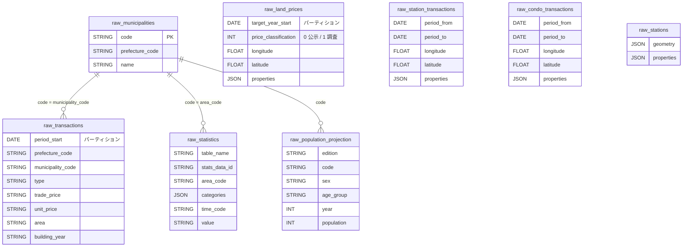
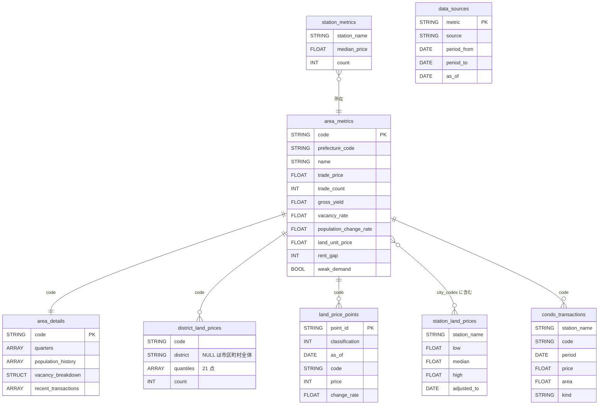
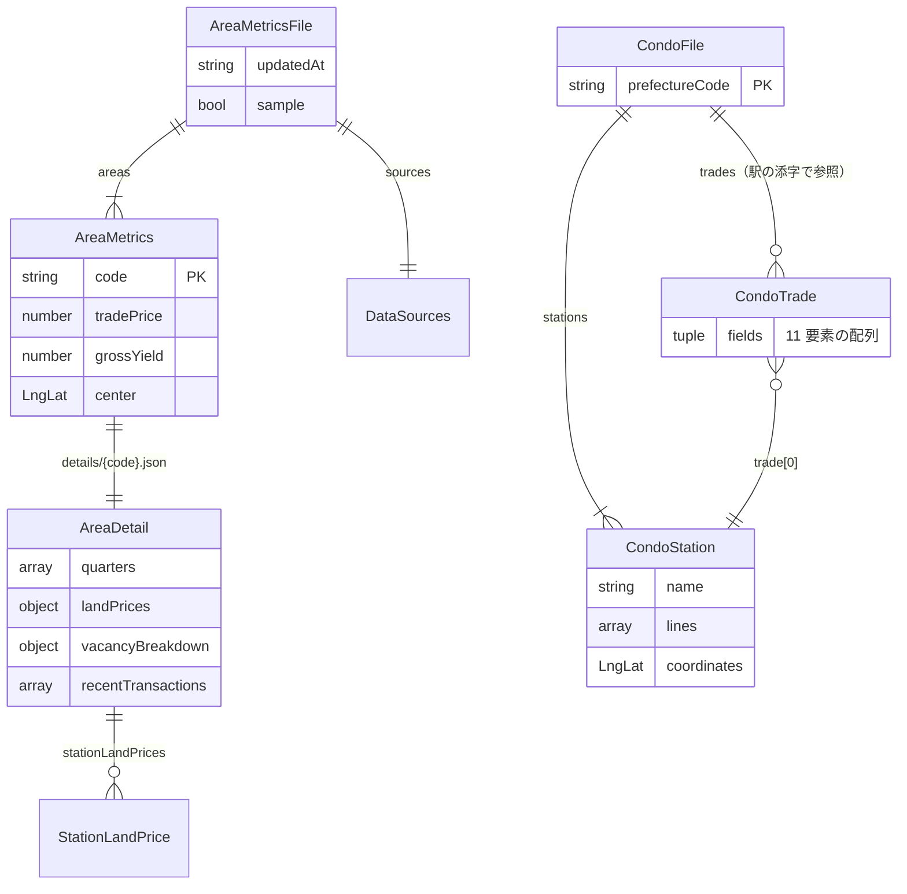
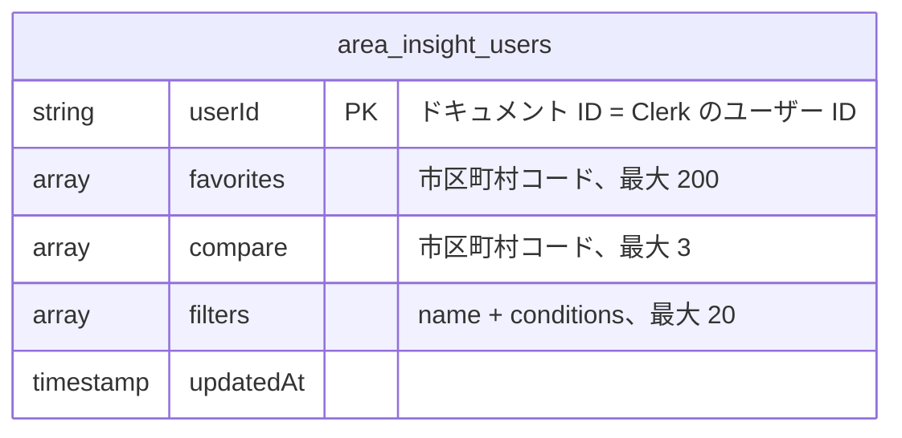

# ER 図

データの置き場所は 3 つ。どれも**市区町村コード（5 桁）**でつながる。

| 置き場所 | 中身 | 詳細 |
|---|---|---|
| BigQuery | raw テーブルと集計テーブル | [バッチ](detailed-design/batch.md) |
| 画面向けファイル | 集計テーブルを画面の形にした JSON | [画面](detailed-design/web.md#7-データの準備) |
| Firestore | 利用者のデータ | [保存 API](detailed-design/api.md) |

## 1. BigQuery: raw テーブル

公的 API の応答を加工せずに入れる。値は文字列のまま（数値化は集計 SQL で行う）。

全テーブルに `fetched_at`（取得日時）がある。地点・駅系は座標で結び付けるため、コードの関連線は引いていない。

## 2. BigQuery: 集計テーブル

`aggregate` が `CREATE OR REPLACE` で作り直す。

列は主なものだけ。指標の意味は [ユビキタス言語](ubiquitous-language.md#指標市区町村ごと)。書き出し時は各行の先頭に `export_id` が付く。

## 3. 画面向けファイル

`apps/web/scripts/prepare-data.mjs` が書き出しを変換して `src/data/generated/` に置く。形は `packages/shared/src/area.ts` の zod スキーマ。

| ファイル | 中身 | 読み込み |
|---|---|---|
| `metrics.json` | 全国の `AreaMetrics` と出典・時点 | ビルド時に JS へ |
| `details/{code}.json` | 市区町村ごとの `AreaDetail` | プリレンダー時に HTML へ埋め込む |
| `land-prices.json` | 地価の地点 | 地図ページ |
| `stations.json` | 駅ごとの相場 | 地図ページ |
| `condos/{pref}.json` | 都道府県ごとの `CondoFile` | マンションページで選んだ分だけ fetch |

## 4. Firestore

コレクション名は `area-insight-users`。1 利用者 1 ドキュメント。保存は全体の上書き。
