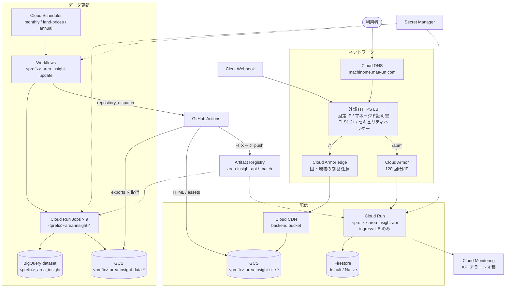

# インフラ構成図（Google Cloud）

正は [maa-un/maaun-terraform](https://github.com/maa-un/maaun-terraform) の `envs/dev/gcp`。リージョンは `asia-northeast1`（東京）。

- `platform` レイヤ: 長く使うもの（データ、バケット、DNS、証明書、SA、Secret）
- `app` レイヤ: 作り直せるもの（Cloud Run、Workflows、Scheduler、LB、Cloud Armor）

リソース名の `<prefix>` は Terraform の `name_prefix`。

## 構成図

## リソース一覧

| 種類 | 名前 | 役割 |
|---|---|---|
| BigQuery | `<prefix>_area_insight` | raw と集計のテーブル（[ER 図](er-diagram.md)） |
| GCS | `<prefix>-area-insight-data-<project>` | 書き出し `exports/`。非公開 |
| GCS | `<prefix>-area-insight-site-<project>` | 静的サイト。読み取り公開。404 は `404.html` |
| Firestore | `(default)` | 利用者のデータ。削除保護あり |
| Cloud Run Jobs | `<prefix>-area-insight-<ジョブ名>` | バッチ 9 ジョブ（下表） |
| Cloud Run | `<prefix>-area-insight-api` | 保存 API。CPU 1 / 512Mi、`/healthz` で起動確認 |
| Workflows | `<prefix>-area-insight-update` | ジョブを順に実行し、最後に GitHub へ通知 |
| Cloud Scheduler | `<prefix>-area-insight-{monthly,land-prices,annual}` | Workflows を起動 |
| LB | `<prefix>-area-insight` | `/api/*` は API、それ以外はサイト。HTTP は HTTPS へ 301 |
| Cloud Armor | `-edge` / `-api` | 公開前の国制限（任意） / API のレート制限 |
| Secret Manager | 下表 | API キーなど。値は手で登録 |
| Artifact Registry | `area-insight-api`、`area-insight-batch` | イメージ（`vX.Y.Z`） |
| Monitoring | API のアラート | インスタンス数上限近く、5xx、429、p95 遅延 |

旧ドメイン `gc.maa-un.com` は同じ LB で受け、画面は `machinome.maa-un.com` へ 301。`/api/*` は転送しない（Webhook 用）。

## バッチのジョブ

| ジョブ | メモリ | 上限時間 |
|---|---|---|
| municipalities | 512Mi | 1h |
| transactions | 1Gi | 1h |
| station-transactions | 2Gi | 2h |
| condo-transactions | 1Gi | 2h |
| stations | 512Mi | 2h |
| land-prices | 2Gi | 24h |
| statistics | 512Mi | 30m |
| projections | 1Gi | 30m |
| aggregate | 512Mi | 30m |

すべて CPU 1、再試行 1 回。中身は [バッチの詳細設計](detailed-design/batch.md)。

## 定期実行

時刻は日本時間。各回の最後に `aggregate` を実行し、画面を作り直す。

| スケジュール | 日時 | ジョブ |
|---|---|---|
| monthly | 毎月 3 日 4:00 | municipalities → transactions → station-transactions → condo-transactions → aggregate |
| land-prices | 4 月 10 日 4:00 | land-prices → aggregate |
| annual | 10 月 10 日 4:00 | statistics → projections → stations → land-prices → aggregate |

## サービスアカウントと権限

| SA | 使う部品 | 権限 |
|---|---|---|
| `batch` | Cloud Run Jobs | BigQuery dataEditor・jobUser、データ用バケット objectAdmin、Secret（reinfolib、e-Stat） |
| `wf` | Workflows / Scheduler | ジョブの run.invoker、workflows.invoker、Secret（GitHub 通知用トークン） |
| `api` | 保存 API | Firestore（datastore.user）、Secret（Clerk Webhook 署名鍵） |
| `deploy` | GitHub Actions | Artifact Registry writer、データ用バケット読み取り、サイト用バケット書き込み、CDN の無効化だけのカスタムロール |

GitHub Actions は Workload Identity 連携で入る。信頼するのは area-insight リポジトリの `main` と `vX.Y.Z` タグだけ。

## Secret Manager

| Secret（`<prefix>-area-insight-…`） | 使う SA | 環境変数 |
|---|---|---|
| `reinfolib-api-key` | batch | `REINFOLIB_API_KEY` |
| `estat-app-id` | batch | `ESTAT_APP_ID` |
| `github-dispatch-token` | wf | （Workflows が直接読む） |
| `clerk-webhook-secret` | api | `CLERK_WEBHOOK_SECRET` |

## 配信の設定

| 項目 | 値 |
|---|---|
| CDN | `CACHE_ALL_STATIC`、既定 TTL 1h、最大 1 日、stale 配信 1 日 |
| assets | `max-age=31536000, immutable`。JSON は gzip で置く |
| HTML | `max-age=300`。配置後に CDN を全パス無効化 |
| ヘッダー | HSTS、CSP、nosniff、Referrer-Policy、Permissions-Policy |
| CSP の外部許可 | Clerk、Cloudflare Turnstile、地理院タイル、OpenFreeMap |
