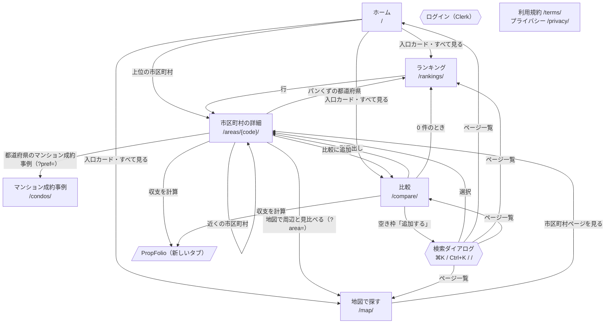

# 画面遷移図

各ページの中身は [画面の詳細設計](detailed-design/web.md)。

## 遷移図

全ページ共通:

- メニュー（広い画面は左サイドバー、狭い画面は下のタブバー）から ホーム / 地図 / マンション / ランキング / 比較 へ移れる
- 検索ダイアログとログイン（Clerk の画面）はどのページからも開ける
- フッターから利用規約・プライバシーポリシーへ

## ページ一覧

| ページ | URL | 主な URL クエリ | 備考 |
|---|---|---|---|
| ホーム | `/` | — | |
| 地図 | `/map/` | `metric`, `area` | 境界データを読み込む |
| マンション成約事例 | `/condos/` | `pref`, `years`, `kind`, `plans`, `amin`, `amax`, `agemin`, `agemax`, `special` | 都道府県ごとにデータを読み込む |
| ランキング | `/rankings/` | `metric`, `order`, `pref`, `ref`, `nodata`, `page` | |
| 比較 | `/compare/` | `codes`（最大 3） | |
| 市区町村の詳細 | `/areas/{5 桁コード}/` | — | 市区町村の数だけある |
| 利用規約 / プライバシー | `/terms/`, `/privacy/` | — | |
| 版 | `/version/` | — | noindex、sitemap に入れない |
| 404 | `404.html` | — | 該当しないパス |
| 401 | `401.html` | — | 公開前の制限で LB が返す |

URL クエリは `history.replaceState` で書き換え、履歴を増やさない。
