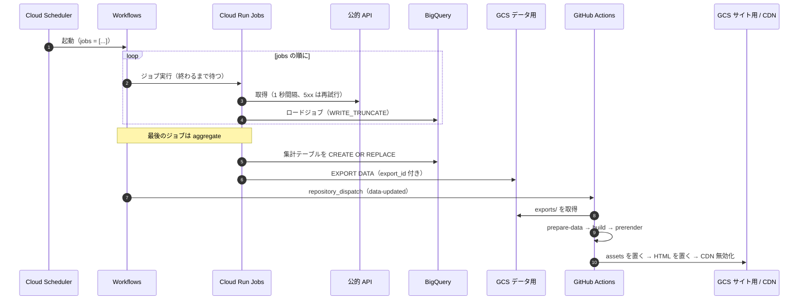
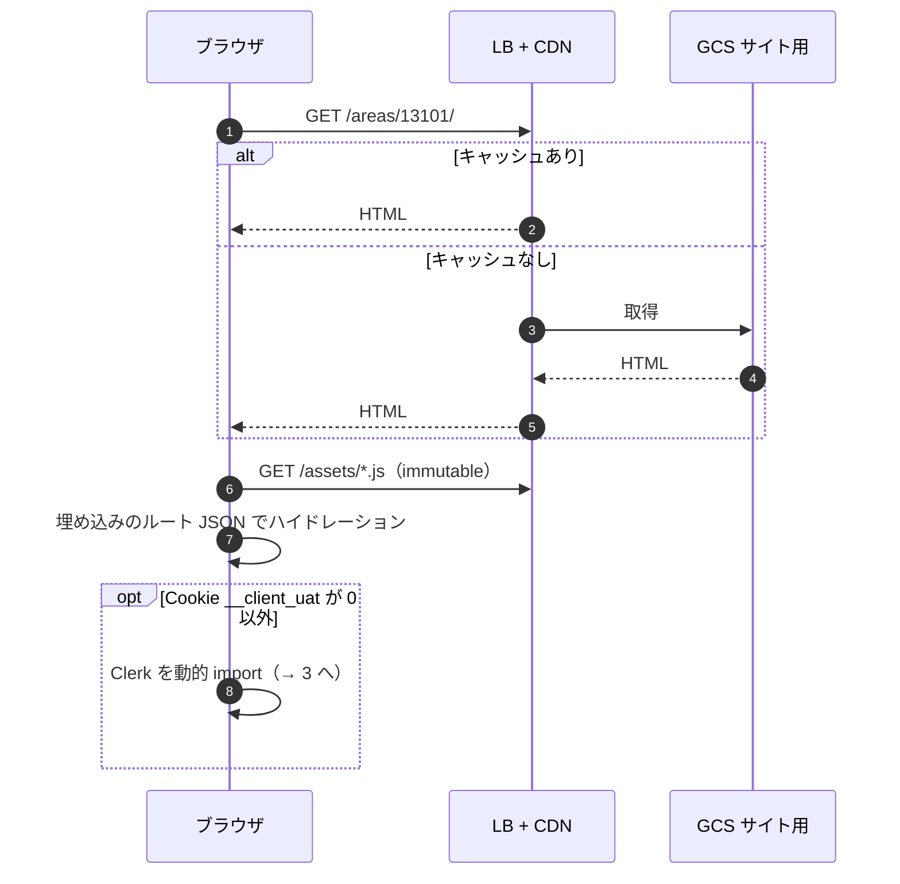
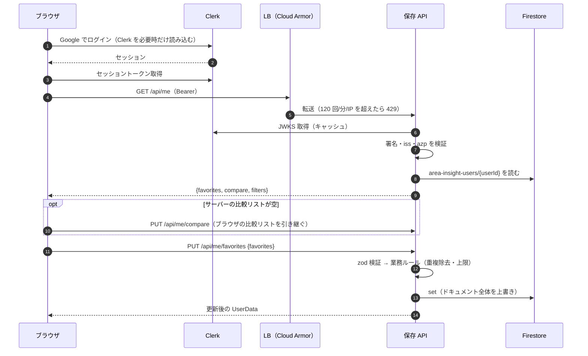
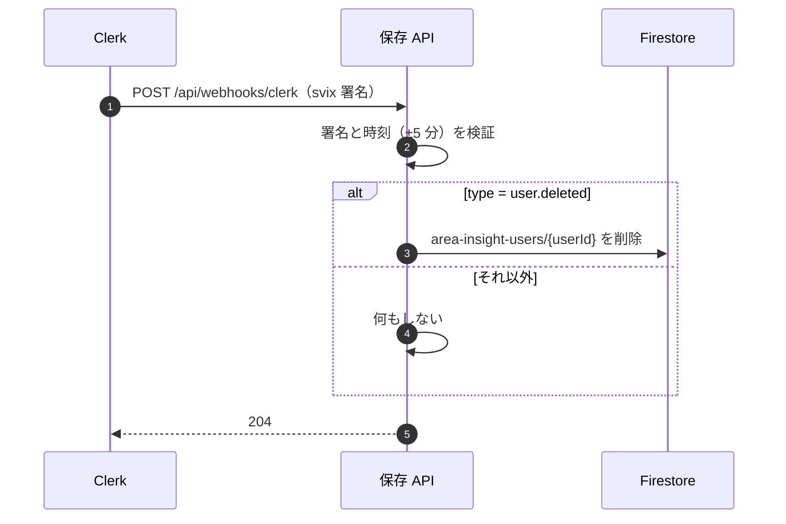
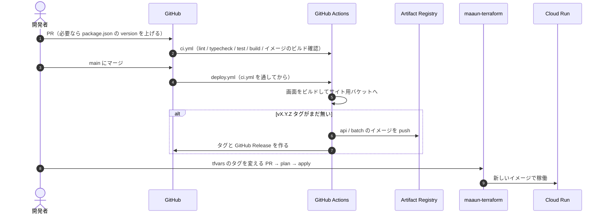

# シーケンス図

部品は [システム構成図](system-architecture.md)、リソースは [インフラ構成図](infrastructure.md) と同じ名前を使う。

## 1. データ更新

途中のジョブが失敗したら、Workflows はそこで止まる。raw も画面も前回のまま残る。

## 2. 閲覧

詳細データは HTML に埋め込み済みなので、閲覧で API も DB も呼ばない。

## 3. ログインと保存

## 4. アカウント削除

## 5. リリース

CI から Cloud Run を直接更新しない。
