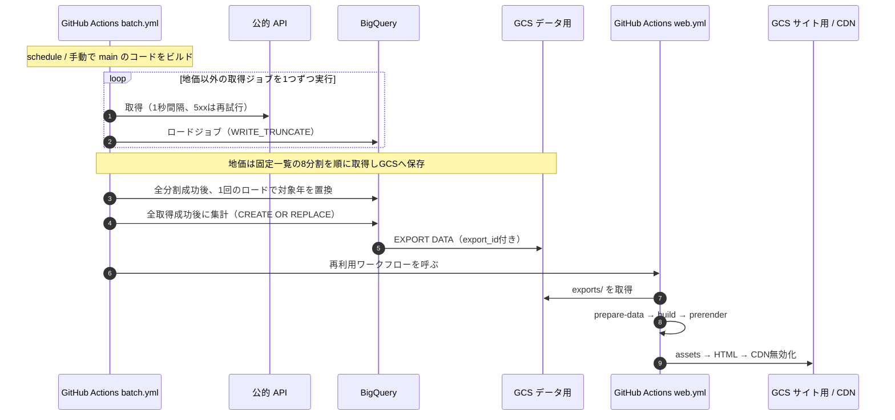
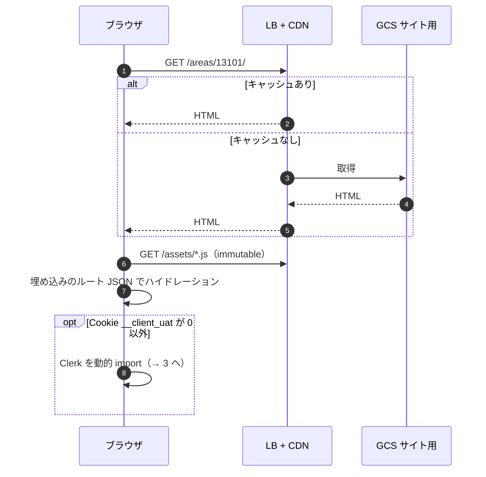
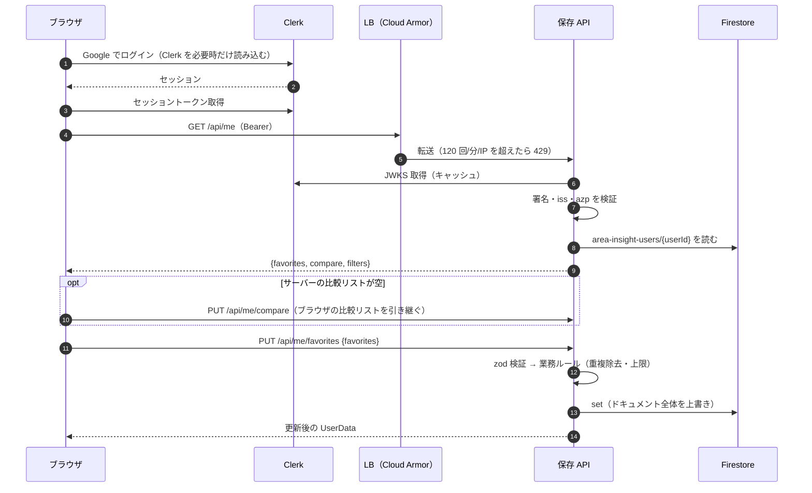
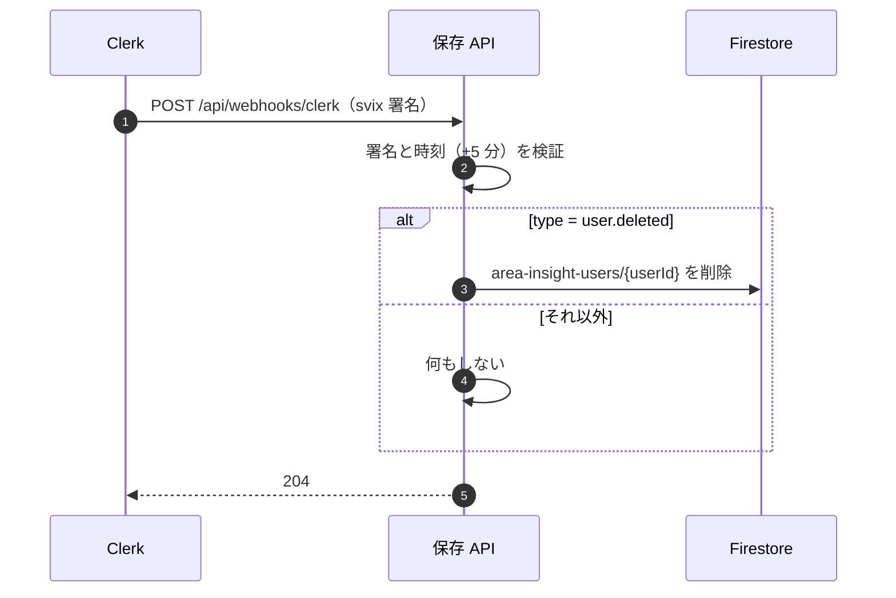
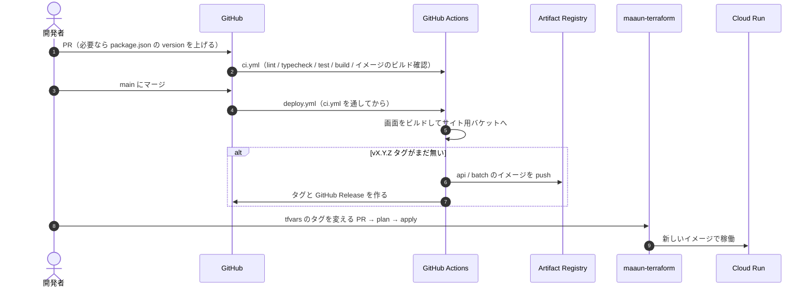

# シーケンス図

部品は [システム構成図](system-architecture.md)、リソースは [インフラ構成図](infrastructure.md) と同じ名前を使う。

## 1. データ更新

取得に失敗したジョブはロードせず、その対象範囲のrawを前回のまま残す。地価も全分割が成功するまで本番テーブルを更新しない。取得が1つでも失敗すれば集計・画面更新は実行しない（それ以前に成功した別ジョブのrawは更新済み）。

## 2. 閲覧

詳細データは HTML に埋め込み済みなので、閲覧で API も DB も呼ばない。

## 3. ログインと保存

## 4. アカウント削除

## 5. リリース

CI から Cloud Run を直接更新しない。
