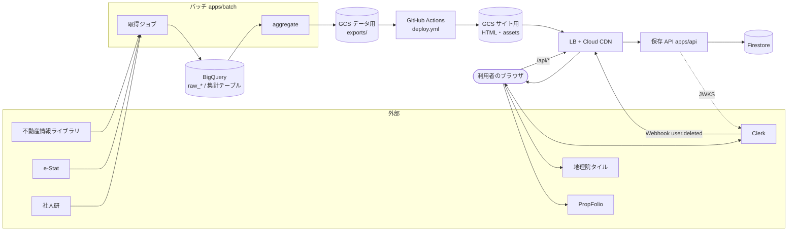

# システム構成図

アプリの部品とデータの流れ。GCP のリソース名は [インフラ構成図](infrastructure.md)。

## 全体



## 流れごとの要点

| 流れ | 経路 | 頻度 |
|---|---|---|
| データ更新 | 公的 API → バッチ → BigQuery → GCS → Actions → サイト用バケット | 月 1 回ほか（[インフラ](infrastructure.md#定期実行)） |
| 閲覧 | ブラウザ → LB → CDN → サイト用バケット | 常時（サーバー処理なし） |
| 保存 | ブラウザ → LB（`/api/*`） → 保存 API → Firestore | ログイン利用者の操作時 |
| 退会 | Clerk → LB → 保存 API → Firestore の削除 | アカウント削除時 |

各流れの順序は [シーケンス図](sequence-diagrams.md)。

## リポジトリの構成

```
area-insight/
├─ apps/
│  ├─ batch/    取得・集計（Cloud Run Jobs）
│  ├─ api/      保存 API（Cloud Run）
│  └─ web/      画面（静的サイト）
├─ packages/
│  └─ shared/   型・zod スキーマ・定数
└─ docs/        この仕様書
```

インフラ定義はこのリポジトリに置かない（maaun-terraform で管理）。
